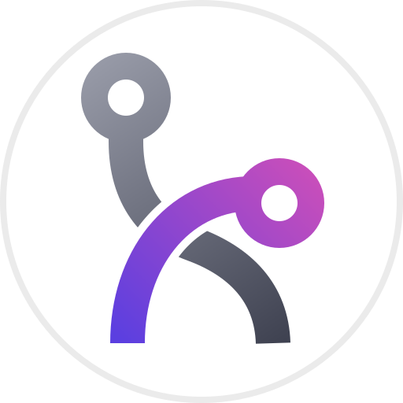
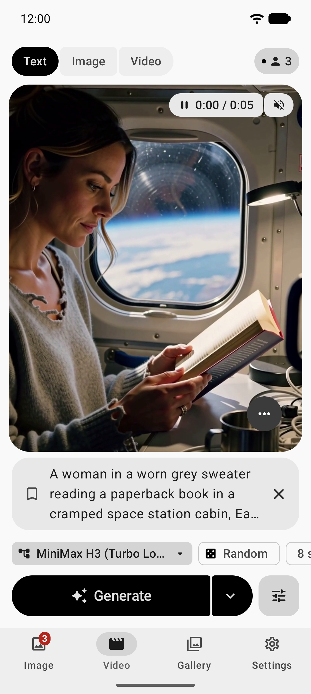
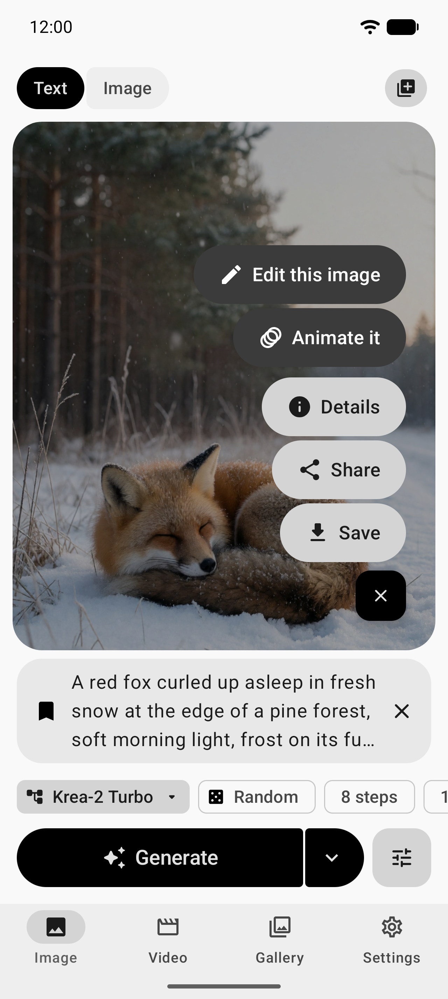
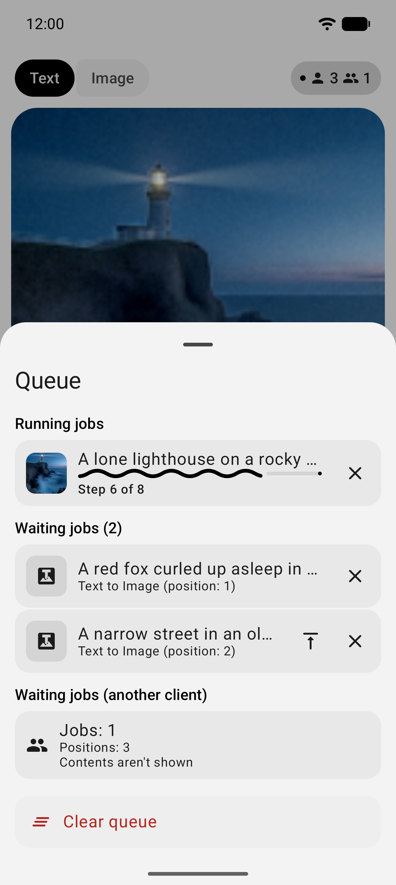
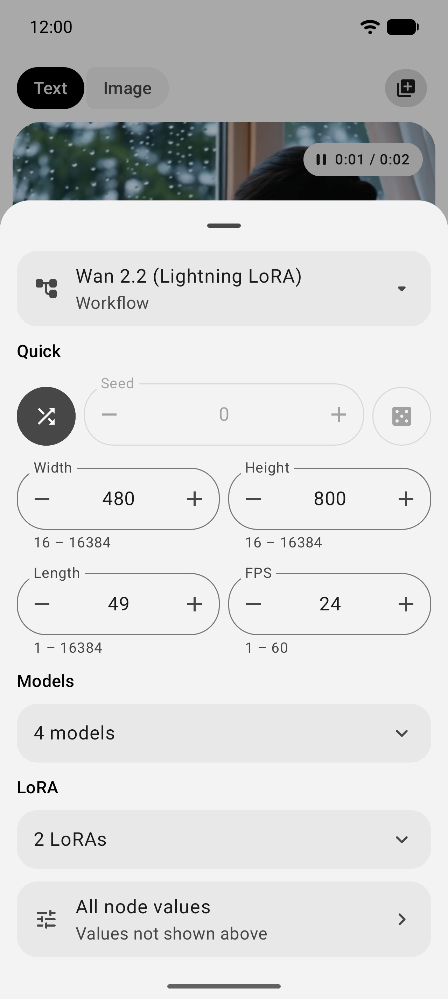
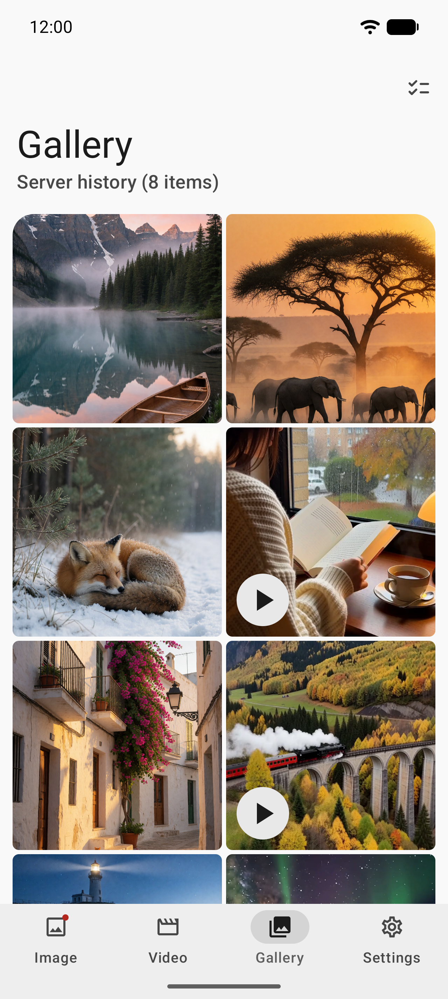
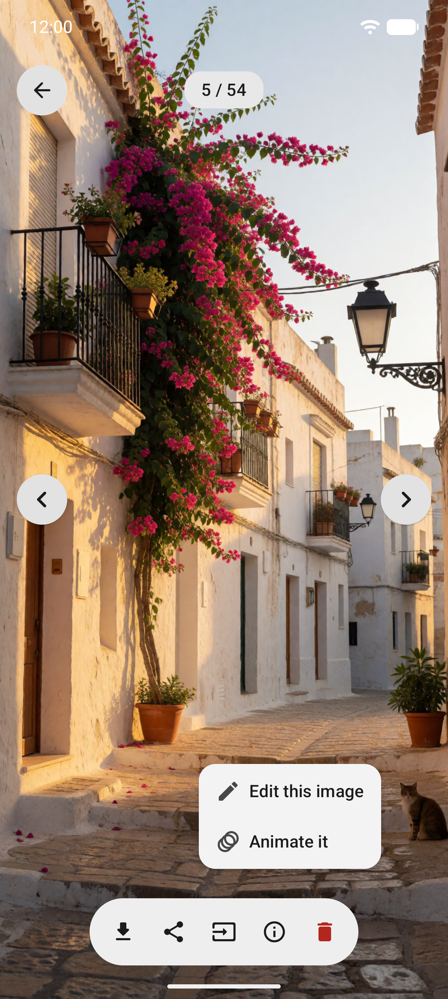
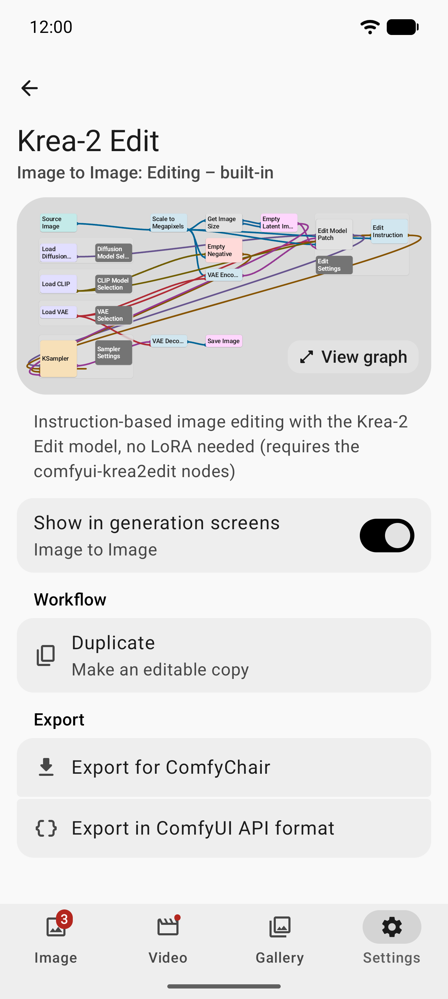
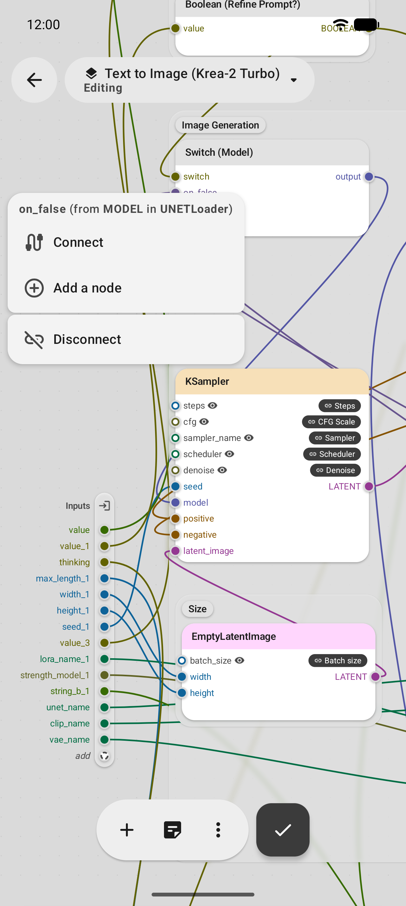

#  ComfyChair

An unofficial, native Android UI for [ComfyUI](https://github.com/comfyanonymous/ComfyUI).

**Current version**: v0.9.0

[](https://github.com/legal-hkr/comfychair/releases/latest)
[](https://f-droid.org/packages/sh.hnet.comfychair)

## Overview

ComfyChair provides a streamlined mobile interface for interacting with ComfyUI servers, allowing you to generate and manage AI images and videos directly from your Android device. The app communicates with your ComfyUI server via its API, bringing the power of node-based AI generation to your mobile workflow.

**Note**: This is an independent, community-developed project and is not officially affiliated with or endorsed by the ComfyUI team.

## Screenshots

       

## Features

### General

- **Material 3 Expressive design**: Image, Video, Gallery and Settings tabs, each generation screen keeping its own state; Back retraces every step with the predictive back animation
- **Multi-server support**: Save and manage multiple ComfyUI server connections with per-server settings and optional auto-login
- **Server connection**: Connect to remote or local ComfyUI servers over HTTPS or HTTP, with HTTPS tried first
- **Certificate trust**: Certificates trusted by Android are accepted as usual; self-signed or private-CA certificates are accepted after you confirm their SHA-256 fingerprint, and from then on only that certificate is accepted for the server. A server that used HTTPS is never switched to unencrypted HTTP without asking
- **Authentication**: HTTP Basic Auth, API key/Bearer token, and browser-based SSO sign-in for servers behind reverse proxies
- **Offline mode**: Browse what is stored on the device without a network connection, offered automatically when the server can't be reached
- **Queue**: Submit several jobs without waiting. A chip in the top bar counts your jobs and other clients' jobs apart; the queue sheet lists your running and waiting jobs with cancel, move to front and remove, shows other clients' jobs only as a count, and can clear the queue
- **Dual workflow support**:
  - **Checkpoint mode**: Traditional CheckpointLoaderSimple workflows
  - **UNET mode**: Modern diffusion workflows (Flux, Z-Image, etc.) with separate UNET, VAE, and CLIP model selection
- **LoRA chain support**:
  - Add up to 5 LoRAs per chain with individual strength from -100 to 100 (coarse stepper plus fine slider)
  - Text to Image and Image to Image: Separate LoRA chains for Checkpoint and UNET modes
  - Video workflows: Separate High Noise and Low Noise LoRA chains
  - LoRAs are dynamically injected into workflows at generation time, including workflows with non-core model loaders such as GGUF
- **Prompt Library**:
  - Save prompts as reusable presets with custom names and tags
  - Organize presets with favorites and tag-based filtering
  - Search presets by name, prompt text, or tags
- **What's new**: This version's release notes under Settings -> About, and a one-time notice after an update
- **Errors**: Every error appears as a snackbar; Show opens the whole error (the node that failed with the server's message and traceback, the inputs a server refused, the reason a connection failed) to read or copy
- **Localization**: Available in English (default), German, French, Polish, Spanish, and Chinese with per-app language selection
- **Native Android experience**: Built with Kotlin and Jetpack Compose with Material Design 3

### Generation

- **One layout for every mode**: the preview on top, a dock with the prompt, the workflow chip and parameter chips below it, and the Generate button
- **Prompt editor**: Tapping the prompt opens a full-screen editor with Positive and Negative tabs, the prompt library and its own Generate button
- **Parameter chips**: Seed, steps, size or megapixels, length and scale one tap away, with the same controls as the options sheet
- **Options sheet**: Only the fields the workflow uses, in sections (workflow, quick, sampling, LoRA, models); large workflows get collapsible sections
- **Generate button**: Generate, or add to the front of the queue and cancel your running job from its menu
- **Progress**: A status card on the preview shows the step and elapsed time, with live preview images when the server sends them
- **Results**: Jobs with several results get a pager with a thumbnail strip; videos play inline with a pause and position chip; one menu on the result saves, shares, shows details and sends it to another screen as its source: an image to edit or animate, a video to edit in Video to Video, or its last frame to animate on from where it ends
- **Text to Image** and **Text to Video**: From a prompt, with High Noise / Low Noise UNET and LoRA selection for video
- **Image to Image**:
  - Two modes: **Editing** (transformation, with its own prompt and up to 2 reference images) and **Inpainting** (mask-based, with a mask editor with adjustable brush size and feathered edges)
  - The source and the result swap through a picture-in-picture thumbnail; the source has its own toolbar (replace, remove, mask tools)
- **Image to Video**: Animate a still image with adjustable length and frame rate
- **Video to Video**: Restyle, restore or upscale a video, from your files or from a result (up to 100 MB, kept like the results: in memory only by default); the source video plays in the preview and swaps with the result
- **Video length**: Checked against the frame grid of the workflow's own nodes (e.g. 4n+1 for Wan, 17n+5 for MiniMax H3), with no upper limit of the app's own
- **Validation feedback**: The inputs ComfyUI refused, and a warning when it skips outputs instead of silently delivering an incomplete result

### Media

- **Gallery**:
  - All generated images and videos in an adaptive grid with a collapsing top bar and pull to refresh
  - Select items with a long press for saving, sharing or deleting them together; the other results of the selected jobs are marked, as the server deletes whole jobs
- **Media viewer**:
  - Opens out of the tile or preview and returns into it; swipe down or use predictive back to close
  - Swipe between items, pinch to zoom, double tap to switch between fit and fill, single tap to hide the controls
  - Save, share, use as source (images and videos), details (generation parameters such as prompt, model, seed and steps) and delete
- **Undo**: Every deletion of media can be undone for a few seconds before it reaches the server
- **Media management**: Save to device gallery (Pictures/ComfyChair or Movies/ComfyChair) or share
- **Media storage**: Generated media is kept in memory only by default and never written to the device; optionally it can be saved on exit or stored on the device. In memory-only mode the app is also hidden from the recents screen preview

### Workflows

- **Workflow editor** in four modes: Graph (read-only, from a workflow's page), Node values (from the options sheet), Edit structure (your own workflows and new ones) and Map fields (import)
- **Node graph**:
  - Nodes and connections in ComfyUI's colors, adapted to the app's light and dark themes, with Bezier curves or Hermite splines
  - Zoomed out below about 40 %, nodes become blocks with their titles; tap one to zoom in to it
  - The selected node's connections are emphasized while the others recede
  - Opens fitted into the free area of the screen, laid out for its proportions
- **Node values**: A bottom sheet with every editable input of a node (numeric steppers with range hints, switches, image previews, the inputs the generation screen fills in), its changed values marked and resettable one by one or all at once
- **Node management**:
  - Add nodes via a searchable node browser with category chips, human-readable names, and deprecated and experimental nodes marked
  - Long-press an output socket to open the node browser filtered by compatible types
  - Delete, duplicate, bypass and rename nodes; clean up disconnected nodes
  - Connect by tapping an output socket and then an input socket (or vice versa); compatible sockets are ringed while a connection waits
  - Organize nodes into groups and add notes with Markdown support; groups are laid out apart like nodes
- **Field mapping**: When importing, the app's fields are assigned one at a time on a card, with a list of all fields; no field is required except the source image for image workflows, and workflows without a prompt (e.g. upscalers) are supported
- **Workflow management**:
  - Create workflows from scratch or import existing ones from ComfyUI
  - Supported formats:
    - ComfyUI LiteGraph (import only) - native ComfyUI workflow format with subgraph support; widget values are read as ComfyUI lays them out, dynamic inputs and extensions' named values included
    - ComfyUI API JSON (import/export) - workflow format used by the ComfyUI API
    - ComfyChair JSON (import/export) - preserves field mappings and app settings
  - A list of workflows with filters and a switch for each, so the generation screens offer only the ones you use; each workflow's page shows its graph and description
  - Prompts can be mapped to primitive String nodes, so one prompt can feed several text encoders
  - Video to Video workflows read the source with ComfyUI's LoadVideo or VideoHelperSuite's Load Video. VideoHelperSuite's node fails on a video without sound when its audio output is connected; LoadVideo with Get Video Components handles such videos
  - Built-in templates include SD, SDXL, Flux, HiDream, Qwen Image (generation and editing), Z-Image, Krea-2 (generation, editing, identity editing and LanPaint inpainting), SeedVR2 image and video upscaling, Wan 2.2, LTX-2 and MiniMax H3 (text, image and video to video with sound, full and Turbo LoRA)
  - Dynamic parameter constraints based on workflow node definitions; each workflow remembers its own generation settings

### Settings

- **Server**: ComfyUI, OS, Python and PyTorch versions, RAM and VRAM meters, freeing memory and unloading models, clearing the history
- **App**: Connection, generation, media and privacy, language and workflow editor pages; changes apply at once, without restarting the app
- **Data**: Backup and restore of the configuration (connections, workflow values, custom workflows), clearing the cache, the debug log, and restoring the app to its installed state while keeping the servers

## Requirements

- Android 13 (API level 33) or higher
- Access to a running ComfyUI server instance
- Network connectivity to reach your ComfyUI server

## Development setup

### Prerequisites

1. **Android Studio** (latest stable version recommended)
2. **JDK 11** or higher
3. **Android SDK** with API level 36

### Building the project

1. Clone the repository:
   ```bash
   git clone https://github.com/legal-hkr/comfychair.git
   cd comfychair
   ```

2. Set up your local environment:
   - Ensure `JAVA_HOME` is set to your JDK installation
   - Configure Android SDK path in `local.properties`

3. Build the app:
   ```bash
   ./gradlew assembleDebug
   ```

4. Run on device/emulator:
   ```bash
   ./gradlew installDebug
   ```

### Running tests

```bash
# Unit tests
./gradlew test

# Instrumented tests (requires device/emulator)
./gradlew connectedAndroidTest
```

## Configuration

To connect to your ComfyUI server, you'll need:
- ComfyUI server URL (e.g., `http(s)://192.168.1.100:8188`)
- Network access between your Android device and the ComfyUI server

## Tech stack

- **Language**: Kotlin 2.2.10
- **Min SDK**: Android 13 (API 33)
- **Target SDK**: Android 16 (API 36)
- **UI Framework**: Jetpack Compose with Material Design 3 (including Expressive components)
- **Video Playback**: Media3 ExoPlayer
- **Architecture**: MVVM with ViewModels and StateFlow
- **Navigation**: Jetpack Compose Navigation
- **Build system**: Gradle with Kotlin DSL

## Contributing

This project follows standard Android development practices:
- Kotlin coding conventions
- Jetpack Compose best practices
- Material Design 3 guidelines
- MVVM architecture pattern

## License

[GPL-3.0](https://www.gnu.org/licenses/gpl-3.0.en.html)

## Acknowledgments

- [ComfyUI](https://github.com/comfyanonymous/ComfyUI) - The powerful node-based UI this app interfaces with
- [Claude](https://claude.ai) by Anthropic - AI assistant that provided valuable support during the development process, helping with code implementation, architecture decisions, and documentation
